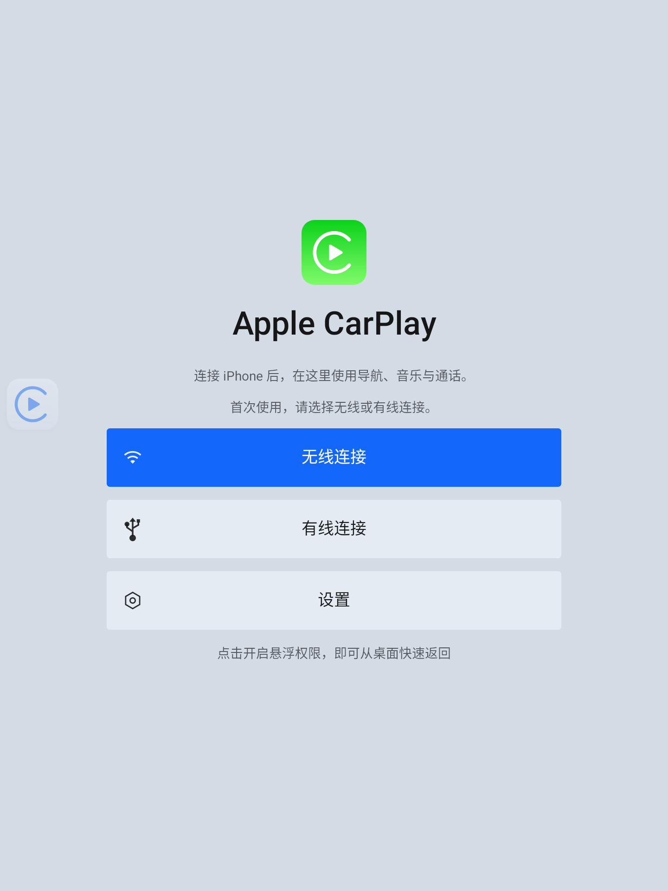
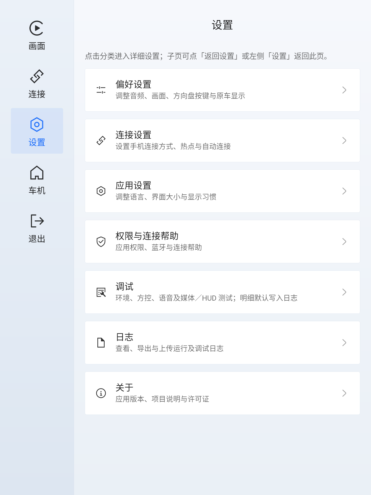
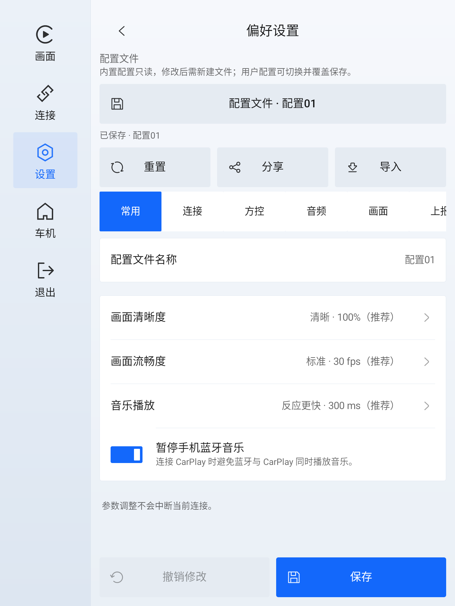

# Galaxy Play

**专为吉利银河 L6 / L7 竖屏车机设计的开源 CarPlay 接收端**

[](#适配范围)
[](docs/使用说明.md)
[](https://github.com/shihabal3amri/DiPlay)
[](LICENSE)

[](docs/使用说明.md#安装与首次启动)
[](docs/开发与验证.md)

[下载安装](https://github.com/Tamshen/GalaxyPlay/releases) · [使用说明](docs/使用说明.md) · [更新记录](docs/更新记录.md) · [问题反馈](https://github.com/Tamshen/GalaxyPlay/issues)

Galaxy Play 基于 [DiPlay](https://github.com/shihabal3amri/DiPlay)，将 iPhone 的 CarPlay 画面、声音与触控交互接入车机。项目的差异化重点是 **吉利银河 L6 / L7 的专用适配**，从界面、硬件到原车服务，围绕这两款车的使用环境进行设计。

**低权限运行，不直接接入或修改 QNX 实时操作系统。** 本应用运行于车机 Android 侧，媒体与导航通过原车 Android 接口上报，后续分发由原厂服务负责。

文件存储权限按需申请；车机桌面悬浮窗按钮需要单独授予悬浮权限，应用内悬浮按钮无需系统悬浮权限。麦克风、蓝牙等权限按所用功能及固件授权情况申请，详见[使用说明](docs/使用说明.md)。

> [!IMPORTANT]
> **专为吉利银河 L6 / L7 竖屏车机设计，其他车型未必可以使用。**
> 能够安装不代表画面、声音、连接和原车服务兼容；同车型不同年款、固件也需分别验证。

## 为银河 L6 / L7 而设计

| 适配特性 | 状态 | 设计说明 |
| :--- | :---: | :--- |
| **GUI 设计** | ✅ 实现 | 参考 Flyme Auto 风格，为 1440×1920 竖屏设计原生界面，提供固定设置侧栏、昼夜主题与悬浮菜单，适配系统栏和实际投屏区域。 |
| **硬件加速** | ✅ 实现 | 针对高通 8155 平台适配，H.264 默认优先 C2 硬件解码；支持 C2、OMX 与 DiPlay 默认选择，检查设备能力并在不可用时回退。 |
| **音频路由** | ✅ 实现 | 分别适配音乐、导航、Siri 与通话的路由、焦点和缓冲，提供 L7 带头枕／无头枕及 L6 配置起点，支持逐项试听。 |
| **Wi-Fi Direct 连接** | ❓ 测试 | 针对车机环境适配信道、IPv4 / IPv6、自动加入准备与重连，保留原生热点方式。 |
| **媒体上报与注册** | ✅ 实现 | 以 Galaxy Play 身份注册原车媒体来源，上报曲目信息、封面与播放状态。 |
| **导航上报** | ✅ 实现 | 通过高德标准广播上报 CarPlay 导航信息，供原车 HUD／仪表接收与显示。 |

此外，项目提供车型配置的保存、复制、二维码分享与文本导入，方向盘按键适配，以及关联连接阶段、真实首帧和配置快照的诊断日志；日志可主动导出或上传。

## 适配范围

目前适配 **吉利银河 L7、L6 竖屏车机**，L7 目标年款为 2023 / 2024，目标平台为高通 8155、Flyme OS / Android 11、13.2 英寸 1440×1920 竖屏，最低 Android 10。最低系统要求不代表其他 Android 车机已获适配，内置模板也不代表所有配置均已实车验证。

项目保留 USB 有线连接，但目前尚未成功连接。各项功能的实车验证状态见[开发与验证](docs/开发与验证.md#验证与验收)。

安装后，在「偏好设置 → 配置文件」选择车型模板并保存，再按连接页面引导使用。完整步骤见[使用说明](docs/使用说明.md)。

## 界面预览

Android 11 AVD 实际截图（v0.1.153，1440×1920）。

| 主界面 | 设置界面 | 常用设置 |
| :---: | :---: | :---: |
| [](docs/images/home.png) | [](docs/images/settings.png) | [](docs/images/preferences.png) |

## 开发与构建

项目采用 **Docker 构建环境**，Android 编译、单元测试、lint 和 APK 打包均在容器中完成。宿主机准备 Git、Python 3 和 Docker，在仓库根目录执行：

```bash
# 在 .env 配置 DIPLAY_AUTH_ASSETS_DIR 后，自动读取证书并打包
bash scripts/build-galaxyplay-host.sh

# 构建不含预置认证身份的源码验证包
bash scripts/build-android-docker.sh --source-only
```

APK 输出至 `mobile/build/outputs/apk/debug/mobile-debug.apk`。**AVD 模拟器独立运行在宿主机**，需单独下载 Android Emulator 和系统镜像，通过 ADB 安装 APK、预览和调试；项目界面预览使用 Android 11、1440×1920 竖屏。

认证配置、完整测试和发布构建见[开发文档](docs/开发与验证.md)，贡献前请阅读[开发规范](AGENTS.md)与[测试说明](docs/测试说明.md)。

## 目录

```text
galaxy/   银河车机适配、界面、车型配置与产品资源
shared/   CarPlay 协议、网络传输、音视频与认证核心
common/   应用宿主与连接生命周期
mobile/   Android APK 入口
e2e/      单元测试、设备测试与检查脚本
scripts/  构建与维护脚本
docker/   构建镜像与工具链配置
tools/    上游同步配置与补丁
docs/     使用、开发、测试、安全、更新记录及界面截图
```

[使用说明](docs/使用说明.md) · [开发与验证](docs/开发与验证.md) · [测试说明](docs/测试说明.md) · [安全与隐私](docs/安全与隐私.md) · [更新记录](docs/更新记录.md)

## 开源与说明

感谢 [DiPlay](https://github.com/shihabal3amri/DiPlay) 提供接收核心，当前基线为 v0.2.15。项目保留 [GPL-3.0](LICENSE) 及原有源码声明，依赖与资源声明可在应用「关于 → 第三方许可」中离线查看。

本项目独立维护，与 Apple、吉利、ECARX 或 Flyme Auto 无隶属或背书关系。使用前请阅读[首次使用须知与风险确认协议](galaxy/common/src/main/assets/galaxyplay-first-use-agreement.md)，数据与凭据处理见[安全与隐私](docs/安全与隐私.md)。
